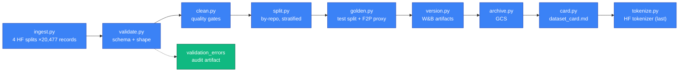

# Dataset Engineering Guide

> How SWE-Qwen turns raw SWE-bench JSONL into a clean, repo-stratified, tokenized training corpus — with the record schema, per-stage quality gates, and aggregate numbers from a real run. Code of truth: `data_engineering/` (one module per stage, orchestrated by `data_engineering/run_pipeline.py`; CLI `python -m data_engineering.cli`, console script `data-pipeline`, subcommands `run` / `tokenize` / `config`), schema in `data_engineering/schema.py`.

**A real run, end to end:**

| Stage | In | Out | Notes |
| ----- | -- | --- | ----- |
| Ingest | — | 20,477 | SWE-bench raw JSONL files |
| Validate | 20,477 | 20,470 (+7 errors) | Schema + patch-shape checks |
| Clean | 20,470 | 17,456 | −12 binary · −1,212 non-Python · −1,149 oversize · −726 duplicates |
| Split | 17,456 | 15,011 / 1,556 / 889 | 46 repos (37/5/4), by-repo to prevent leakage |
| Golden | — | +2,313 | Held out for evaluation |
| Tokenize | 15,011 / 1,556 / 889 / 2,313 | 14,833 / 1,550 / 885 / 2,304 | Qwen3-14B tokenizer, max_len 8,192 (recorded run; over-length dropped, never truncated) |

Clean per-gate counts are recorded independently and can overlap (one record can trip several gates), so they do **not** sum to the 3,014 removed.

Artifacts: W&B `swe-qwen-data` (`dataset-raw:v8`, `validated:v8`, `cleaned:v8`, `train:v23`, `val:v18`, `test:v14`, `golden:v23`, `validation_errors:v2`) + GCS `gs://swe-qwen-datasets/datasets/<run_id>/`.

---

## 1. Record Schema

Every stage operates on the canonical `IssueRecord` (Pydantic, `data_engineering/schema.py`):

| Field | Type | Description |
| ----- | ---- | ----------- |
| `issue_id` | `str` | Stable identifier (SWE-bench `instance_id`-style) |
| `repo` | `str` | Repository (e.g. `django/django`) |
| `pr_number` | `str` | Linked PR, when available |
| `issue_body` | `str` | Problem statement (**validated non-empty**) |
| `patch_diff` | `str` | Gold unified diff (**validated shape**: must parse via `unidiff.PatchSet` or match `---`/`+++`/`@@` headers) |
| `parsed_hunks` | `list[ParsedHunk]` | Parsed hunks: `{file, old_start, old_lines, new_start, new_lines, diff_lines}` |
| `test_results` | `TestResults` | Final-state test outcomes: `{passed[], failed[], errored[]}` |
| `pr_title` / `pr_description` | `str` | PR metadata (context) |
| `commit_messages` | `list[str]` | Commit narrative |
| `files_changed` / `test_files_changed` | `list[str]` | File lists for filtering |
| `issue_labels` | `list[str]` | Labels (topic signals) |
| `repo_domain` | `str` | Domain tag (e.g. `web`, `data`) |
| `metadata` | `dict` | Reserved: verified flag, base/head SHAs, SWE-bench origin |

Two `field_validator`s hard-gate every record at ingestion: `patch_diff` **must** look like a unified diff (unidiff parse first, regex fallback), and `issue_body` **must** be non-empty.

Validation errors are captured, not dropped silently — `ValidationError{record_id, field, error, raw_value}` records feed the `validation_errors` artifact for auditing.

---

## 2. Pipeline Stages



The pipeline runs **nine stages in order**: `ingest` → *(optional BigQuery repo-stat enrichment)* → `validate` → `clean` → `split` → *(optional synthetic augmentation, train split only)* → `golden` → `version` (W&B artifacts) → `archive` (GCS) → `card` (`dataset_card.md`) → `tokenize`. Tokenize is **last** — every earlier stage emits JSONL; only `tokenize` produces model-ready tensors.

### 2.1 Ingest — `swebench_ingest.py`

Loads **four Hugging Face datasets** — `SWE-bench/SWE-bench_Verified` (test split), `SWE-bench/SWE-bench` (test), `SWE-bench/SWE-bench` (dev), and `SWE-bench/SWE-bench` (train, filtered to the 80 Python repos in `SWE_BENCH_PYTHON_REPOS`) — dataset version pinned `2025-04-29`, cached under `data/swe_bench/`. Every example is normalized into an `IssueRecord` and carries over SWE-bench provenance (`metadata`: base/head SHAs, `fail_to_pass`, `pass_to_pass`, `is_verified`) so evaluation can later re-validate against ground truth. A `repo → repo_domain` map tags each record (`data-ml` / `web-api` / `utils` / `testing`). Loading is sequential — no parallel workers.

### 2.2 Validate — `validate.py`

Per-record: Pydantic model validation (both field validators above) + structural checks. The goal is *triage*, not judgment: malformed records are isolated with their errors so the rest of the corpus isn't poisoned.

### 2.3 Clean — `clean.py`

The quality gate — every record that survives is trainable. Six named gates, removals counted in `CleanStats`:

| Gate | Count (real run) | Rationale |
| ---- | ---------------- | --------- |
| `no_test_files` | — | `test_files_changed` empty — no test surface to verify a fix |
| `patch_too_large` | 1,149 | Patch exceeds `--max-patch-lines` (500) — degenerate mega-commits dominate the context window |
| `binary` | 12 | A diff line starts `Binary file` — untrainable |
| `non_python` | 1,212 | Python-file ratio in `files_changed` < 0.5 — repo domain is Python SWE |
| `empty_body` | — | No problem statement → no supervision |
| `no_f2p_signal` | — | No fix/close/resolve keyword in `commit_messages` + `pr_description`, and no `metadata.has_test_patch` — no failing→passing signal |
| Duplicates | 726 | Exact `(repo, issue_id, pr_number)` tuple, or identical SHA256 content hash of `patch_diff` |
| **Total removed** | **3,014** | 20,470 → 17,456 |

Per-gate counts are recorded independently and **can overlap** — a record removed for two reasons counts under both gates — so they do not sum to the total.

**Conditional demotion:** records without SWE-bench "verified" provenance (`metadata.is_verified=False`, e.g. the Train split) keep `no_test_files` and `no_f2p_signal` as **warnings** instead of removal reasons — they are retained for training while verified eval data stays high-quality.

### 2.4 Split — `split.py`

Splits **by repository** (not by record) into train / val / test at the configured ratios (default 80/10/10; strict `SplitRatios`):

- Repos are assigned to exactly **one** split (37 train / 5 val / 4 test = 46 in the real run) — records of the same repo never land on both sides of any boundary, so val/test measure **cross-repo generalization**, not in-distribution recall.
- Seed `42` is pinned (`DEFAULT_SPLIT_SEED`) so the same corpus always splits identically; a run_id-derived seed is used only when `run_id_override` is set.
- `Splits` keeps `golden` separate from the outset.

### 2.5 Optional augmentation & enrichment

Two opt-in flags, both applied to the **train split only, after splitting**:

- `--augment-codecontests` — Python solutions from `deepmind/code_contests` turned into synthetic `IssueRecord`s (repo `synthetic/codecontests`, stub→solution unified diffs).
- `--augment-codealpaca` — `sahil2801/CodeAlpaca-20k`, keyword-filtered (repo `synthetic/codealpaca`).

`--bigquery` (separate flag, runs right after ingest) enriches `metadata` with repo stats from `bigquery-public-data.github_repos.sample_repos`, cached to `bigquery_repo_stats.json`.

### 2.6 Golden — `golden.py`

Carves the **evaluation set** used by the eval harness:

- Default `golden_source_split="test"`: golden is carved from the repo-stratified **test split** using the F2P-keyword proxy — `test_files_changed` non-empty **and** fix/close/resolve keywords in `commit_messages` / `pr_description`. An isolation check logs an error if any golden repo overlaps train/val.
- Output: `GoldenSet{records, f2p_verified_count, source_split}` — the recorded run's golden artifact holds **2,313** instances, held out for evaluation.
- Fixed `run_id` (immutable once evaluated, so compare results stay comparable).


### 2.7 Tokenize — `tokenize.py`

Converts the splits to model-ready sequences:

```bash
python -m data_engineering.cli tokenize \
  --run-id <id> --model-name qwen3-14b --max-seq-length 8192
```

| Setting | Value | Why |
| -------- | ----- | --- |
| Tokenizer | Registry model tokenizer (`AutoTokenizer`, `trust_remote_code`) | Same tokenizer as the base + fine-tune → no id drift |
| `max_length` | `min(registry context_window, trainer max_seq_length)` → **4,096** for `qwen3-14b` by default; the recorded run passed `--tokenize-max-length 8192` | Tokenize ≤ the training window (8,192 on Modal A100-80GB) so nothing is truncated |
| Labels | `[-100] * prompt_len + input_ids[prompt_len:]` | Loss computed on the completion only |
| Over-length records | **Dropped, never truncated** | Truncation would corrupt the prompt/completion boundary (the recorded run dropped 178/6/4/9 in train/val/test/golden) |
| Prompt parity | `inference.prompt_builder.render_system_and_user` | Byte-identical prompts at train and inference time (context files capped at 20, test files at 10, snippets 5 files × 150 lines) |
| Output | `data/{run_id}_tokenized/` — a Hugging Face `DatasetDict` saved via `save_to_disk` (arrow shards + `dataset_dict.json`), splits `train` / `val` / `test` / `golden`; mirrored to GCS under `tokenized/{run_id}/` | Consumed directly by training |

Packing is not a tokenize-side concern — the trainer forces `packing=False` (see the experiments guide).

---

## 3. Quality Criteria (DoD for a record)

1. **Schema**: validates as `IssueRecord` (both validators pass).
2. **Patch**: plausible unified diff, ≤ 500 patch lines, no binary content.
3. **Scope**: Python repository; problem statement present.
4. **Signal**: has a failing→passing test pair (verifiable fix), or is carried as golden.
5. **Uniqueness**: no kept record shares its exact `(repo, issue_id, pr_number)` key, nor the same SHA256 content hash of `patch_diff`.
6. **Leakage**: its repo belongs to one split only.
7. **Auditability**: any failure produced a `ValidationError` with `record_id` + field + reason.

---

## 4. Reproducibility & Versioning

```bash
# Deterministic full run with a named run_id
python -m data_engineering.cli run \
  --run-id expanded-repos \
  --tokenize-model qwen3-14b --tokenize-max-length 8192

# Resume from a checkpoint (skip completed stages)
python -m data_engineering.cli run --run-id expanded-repos --resume-from cleaned --stages split,golden,tokenize

# Dump the effective config
python -m data_engineering.cli config
```

- Every stage writes versioned **W&B artifacts** (immutable tags) and mirrors stage JSONL + lineage files to **GCS** (`datasets/<run_id>/swebench/<stage>.jsonl` + `manifest.json` + `dataset_card.md`, plus `tokenized/<run_id>/` for the tokenized shards); per-stage streaming checkpoints also mirror to GCS during the run.
- `_build_manifest` writes a lineage **`manifest.json`**: `{run_id, source, git_sha, generated_at, stages: {name: {records, bytes, sha256}} for all 8 JSONL stages, effective config}`. Its SHA256 becomes `manifest_hash` on `PipelineResult`, so any change to the corpus, the config or the code moves it. `card.py` then generates `dataset_card.md` from the run's own stats (per-stage counts, 46 repos, quality gates).
- `PipelineResult` records `run_id`, `manifest_hash`, per-repo `RepoResult` counters, `gcs_paths`, `wandb_artifacts`, and `tokenized_paths` — the full lineage of a run in one object.
- `run_pipeline.py`'s `--stages` / `--resume-from` make partial re-runs cheap (resume after a flick of a cleaner rule costs one stage, not 20K records).

---

## 5. Storage Layout

```text
gs://swe-qwen-datasets/
├── datasets/<run_id>/              # per-run pipeline output
│   ├── swebench/
│   │   ├── raw.jsonl · validated.jsonl · cleaned.jsonl
│   │   ├── train.jsonl · val.jsonl · test.jsonl · golden.jsonl
│   │   └── validation_errors.jsonl
│   ├── manifest.json               # lineage manifest: records/bytes/sha256 per stage + effective config
│   └── dataset_card.md             # generated from the run's own stats
├── tokenized/<run_id>/             # model-ready DatasetDict (arrow shards + dataset_dict.json)
└── dataset/                        # shared dataset artifacts

W&B swe-qwen-data (entity <org>):
  artifacts: dataset-raw:v8 · validated:v8 · cleaned:v8 · train:v23 · val:v18 · test:v14 · golden:v23 · validation_errors:v2
```

Per-stage streaming checkpoints also mirror to GCS during the run, which is what makes `--resume-from` cheap after an interruption.

> **Note on public-read:** the GCP org enforces `iam.disableServiceAccountKeyCreation`, which blocks HMAC keys for private-bucket access from Modal. Dev relies on public-read buckets; production swaps to signed URLs / WIF-authorized access.
