# Deep Dives

> Every subsystem below is independently runnable, CI-gated, and covered end-to-end in `docs/`. Model identity resolves through the registry (`registry/` + `config/models.yaml` + gitignored `config/models.user.yaml`) — the `qwen3-14b` values quoted throughout are the current default model's receipts, not hardcodes.

## Component Deep Dives

### 0. Model Registry (`registry/`)

Any open-weight causal LM on Hugging Face plugs into every stage with one command — no tracked config edited, no GPU, no download:

```bash
model add meta-llama/Llama-3.1-8B-Instruct --name llama-31-8b --context 8192 --target-modules auto
model list   # merged view: key · HF id · context · quant · serving base · source file
```

**How `add` validates** (4 HTTP probes via `httpx`, 15 s timeout, follow redirects):

1. `HEAD /api/models/{hf_id}` — repo must exist (exit 1 otherwise).
2. `GET .../resolve/main/config.json` — `--context 0` resolves `max_position_embeddings`; absent/non-int/≤ 0 → exit 1.
3. `GET .../resolve/main/tokenizer_config.json` — chat-template presence (exit 1 unless `--allow-no-template`); also derives `prompt_behavior.no_think` from thinking-capability markers (`enable_thinking` / `chat_template_continue_generation`).
4. `--target-modules auto` — offline stand-in for `peft.find_all_linear_names`: 10 known architecture prefixes get the standard 7-module set, else peft's mapping, else the 7-module default + warning.

`add` writes **only** to `config/models.user.yaml` (gitignored); `load_models()` deep-merges it under the tracked `config/models.yaml` per model key, with an `lru_cache` keyed on both files' mtimes so rewrites invalidate automatically. Every stage — tokenize, train, eval, promote, serve, deploy — reads through `registry/` (env > registry > literal last-resort), so the new key is immediately usable everywhere.

| Per-model field | Drives |
| --------------- | ------ |
| `hf_id` · `context_window` · `target_modules` | tokenize tokenizer + length; QLoRA target modules |
| `quantization` · `fallback_quantization` | Unsloth path + TRL+PEFT+bitsandbytes fallback precision |
| `serving_hf_id` · `serving_quantization` | serving base: pre-quantized (AWQ/FP8) when set, plain bf16/fp16 with the `quantization` kwarg omitted when null |
| `prompt_behavior.no_think` | gates both the `/no_think` insert and the `enable_thinking=False` template kwarg |
| `gpu_mapping` (primary/fallback) | Modal training GPU, serving GPU, device memory budgets |
| `default: true` | the one key all `--model` defaults resolve through (`registry.default_model_key()`) |

**Registry today:** 4 entries — `qwen3-14b` (default: NF4 4-bit, bf16 compute, AWQ serving base `Qwen/Qwen3-14B-AWQ`, `no_think`, a100-80gb primary, context 32,768, 7 LoRA target modules), `smollm2-135m`, `mistral-7b-v03`, and `qwen3-30b-a3b` (retained for future phases). Unknown keys and missing files raise — there is no silent fallback model anywhere in the serving or eval path.

<p align="center">
  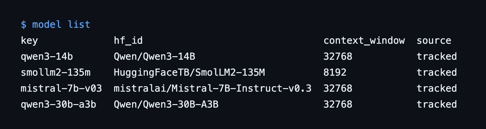
  <br/><em><code>model list</code> — the merged view over <code>config/models.yaml</code> + the user overlay, one row per registered model.</em>
</p>

### 1. Data Engineering (`data_engineering/`)

The data layer turns raw GitHub issue + PR dumps into a tokenized, `pydantic`-typed training corpus — reproducibly, with every stage versioned. The central type is `IssueRecord` (`data_engineering/schema.py`): **15 typed fields** covering identity (`issue_id`, `repo`, `pr_number`), the issue body, the gold patch (`patch_diff` + parsed hunks), test results, PR context (title, description, commit messages), changed files, test files changed, labels, repo domain, and a `metadata` dict carrying SWE-bench provenance (`base_sha`, `head_sha`, `test_patch`, `source_split`, `is_verified`, `instance_id`, …) — validated on ingestion so downstream stages never see malformed rows.

**Under the hood — every stage in one command (`python -m data_engineering.cli run`)**:

| Stage | What actually happens | Live gate |
| ----- | --------------------- | --------- |
| `ingest` | Loads SWE-bench from the local Hugging Face datasets cache (`data/swe_bench/`) — four loads: Verified test, test, dev, and train (filtered to 80 Python repos via `SWE_BENCH_PYTHON_REPOS` + a repo→domain map: data-ml / web-api / utils / testing), dataset version pinned `2025-04-29` → `raw.jsonl` | 20,477 |
| `validate` | Builds `IssueRecord` (pydantic): `patch_diff` must parse as a `unidiff.PatchSet` **or** match `---`/`+++`/`@@` diff headers; field-level errors → `validation_errors.jsonl` | 20,470 ✓ · 7 rejected |
| `clean` | Six counted gates (no test files · patch > 500 lines · binary diffs · non-Python < 0.5 py-ratio · empty body · no F2P signal), then exact `(repo, issue_id, pr_number)` + SHA-256 content dedup → `cleaned.jsonl` | 17,456 ✓ · 726 dup |
| `split` | By-repo 80/10/10 — a whole repo goes to one split to stop cross-repo leakage; seed 42 pinned (run-id-derived only under `run_id_override`) | 15,011 / 1,556 / 889 · 46 repos |
| `golden` | Carves the held-out eval set from the repo-stratified test split (`golden_source_split="test"`, F2P-keyword proxy + test-file presence); an isolation check errors if any golden repo overlaps train/val | 2,313 held out |
| `version` | Logs 8 `dataset-{stage}` W&B artifacts with full per-stage metadata (project `swe-qwen-data`) | 8 artifacts |
| `archive` | Mirrors every JSONL + `manifest.json` + `dataset_card.md` to `gs://swe-qwen-datasets/datasets/{run_id}/` | 8 objects |
| `card` | Generates `dataset_card.md` from the run's own stats (per-stage counts, repos, quality gates, artifact links) | — |
| `tokenize` | Registry tokenizer, `max_length` = min(registry `context_window`, trainer `max_seq_length`) → arrow `DatasetDict` (`train`/`val`/`test`/`golden`) | 14,833 train · 2,304 golden |

Two optional augmenters slot in where the data allows: `--bigquery` (repo stats from `bigquery-public-data.github_repos.sample_repos`, cached to `bigquery_repo_stats.json`) after ingest, and `--augment-codecontests` / `--augment-codealpaca` (synthetic `IssueRecord`s from DeepMind code_contests Python solutions and CodeAlpaca-20k, capped by `--max-train-examples`) applied to the **train split only** after splitting.

**Clean gates, precisely:** `no_test_files` (empty `test_files_changed`), `patch_too_large` (> `--max-patch-lines`, 500), `binary` (line-anchored `Binary file`), `non_python` (Python-line ratio < 0.5), `empty_body`, and `no_f2p_signal` (fix/close/resolve keyword regex over commit messages + PR description, OR `metadata.has_test_patch`). **Conditional demotion:** records without SWE-bench *verified* provenance keep `no_test_files` / `no_f2p_signal` as warnings and are retained — only four gates stay hard for them. Dedup is exact tuple + content hash; per-gate counts overlap, so they don't sum to the total removed.

**Tokenize, precisely:** labels are `[-100] * prompt_len + input_ids[prompt_len:]` (loss only on the completion); over-length examples are **dropped, never truncated**; prompt construction goes through `inference.prompt_builder.render_system_and_user` so train and eval see byte-identical prompts (context files capped at 20, test files at 10, snippets 5 files × 150 lines). Output is a HF `DatasetDict` (`save_to_disk`) under `data/{run_id}_tokenized/`, mirrored to GCS at `tokenized/{run_id}/`.

Every run writes a real `manifest.json` (`run_id`, source, git SHA, generated-at, per-stage `{records, bytes, sha256}` for all 8 JSONL artifacts, effective config) and a `dataset_card.md`; `python -m data_engineering.cli config` dumps the effective `DataPipelineConfig` for reproduction.

<p align="center">
  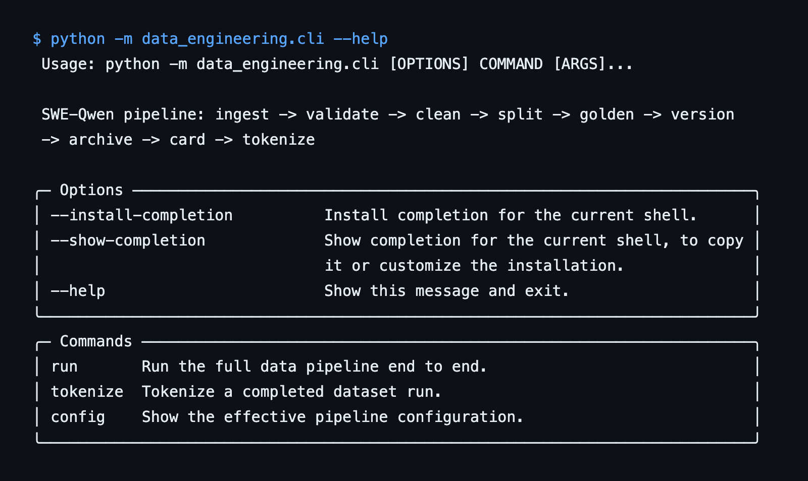
  <br/><em>`python -m data_engineering.cli --help` - one command runs the whole 9-stage pipeline; model, tokenizer and length defaults resolve from the registry.</em>
</p>

<p align="center">
  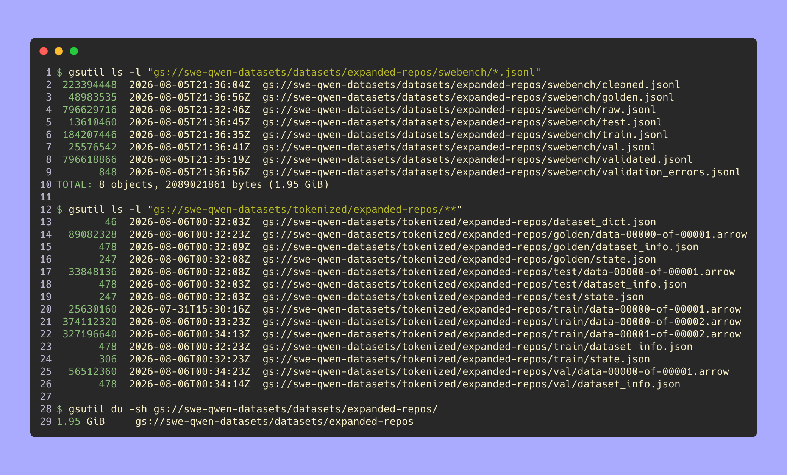
  <br/><em>Live GCS: `datasets/expanded-repos/swebench/*.jsonl` — 8 objects, 1.95 GiB total (raw 796 MB → cleaned 223 MB …).</em>
</p>

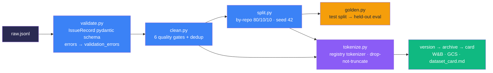

| Parameter | Setting | Rationale |
| --------- | ------- | --------- |
| Max patch lines | 500 (`--max-patch-lines`) | reject model-unanswerable mega-diffs |
| Language gate | Python only (py-ratio ≥ 0.5) | consistent, testable corpus for v1 |
| Binary / empty files | dropped | no junk tokens in training |
| Duplicates | exact key + SHA-256 content (726 removed) | no data inflation |
| Split | per-repo 80/10/10, seed 42 pinned | prevent repo leakage between splits |
| Golden set | carved from the held-out test split; isolation check errors on train/val overlap | eval set drawn from outside the training split |
| Tokenization | registry tokenizer, `max_length` ← min(context_window, trainer window); drop-not-truncate | fits the LoRA training window; exact loss mask |

**Live run numbers** (run id `expanded-repos`): ingest **20,477** → validate **20,470** (7 schema errors) → clean **17,456** (12 binary diffs, 1,212 non-Python records, 1,149 oversized patches, 726 duplicates — per-gate counts overlap) → split **15,011 / 1,556 / 889** (46 repos · 37/5/4) → golden **2,313** held out → tokenized **14,833 / 1,550 / 885 / 2,304** (train/val/test/golden).

**Reproducibility:** any stage can be re-run independently (`--stages ingest,validate,clean`, `--resume-from validated|cleaned`), every run is hash-pinned in `manifest.json` + `dataset_card.md`, and artifacts are versioned in W&B and mirrored to GCS. A shared `data_engineering/diff_utils.py` (stdlib-only) is the single source of truth for diff-file parsing across ingest, prompt building, and patch application. See [docs/dataset.md](dataset.md).

### 2. QLoRA Training (`training/`)

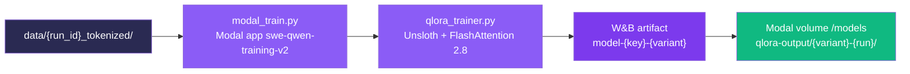

**Five variants configured, three evaluated** (`config/qlora_variants.yaml`):

| Variant | LoRA rank α | lr | batch × grad-accum | epochs | status |
| ------- | ----------- | -- | ------------------ | ------ | ------ |
| `baseline_14b` | r16 · α32 · dropout 0.0 | 2e-5 | 2 × 8 | 1 | evaluated |
| `higher_rank_14b` | r32 · α64 | 2e-5 | 1 × 16 | 1 | evaluated · **champion** |
| `higher_lr_14b` | r16 · α32 · dropout 0.05 | 5e-5 | 2 × 8 | 1 | evaluated |
| `efficient_14b` | r8 · α16 | 5e-5 | 2 × 8 | 2 | quick-debugging config |
| `strong_14b` | r64 · α128 | 1e-4 | 2 × 8 | 3 | production candidate — staged, not yet evaluated |

`dropout 0.0` matters: Unsloth's fast patching path requires it (~2× speedup). Inheritance is implemented in `training/qlora_config.py` — `_get_variant_config` deep-merges a deepcopy of `baseline_14b` under every requested variant, so the YAML only declares deltas.

Shared across all variants: `max_seq_length=4096` (base shape), **`packing=false`** (packing concatenates examples across `-100` prompt boundaries and corrupts the loss mask — enforced in the YAML, in config resolution, and in every GPU override), bf16, `paged_adamw_8bit`, cosine, warmup 0.03, weight decay 0.01, `max_grad_norm=1.0`, gradient checkpointing, `save_steps=10` (a 1-epoch 14B run totals ~16–76 steps — the old 500 produced zero intermediate checkpoints), `save_total_limit=3`, `eval_strategy="no"` (in-training eval OOMs on A10G — evaluation is a separate execution-based step by design), `report_to="wandb"`. GPU: registry `gpu_mapping` primary → **A100-80GB**, timeout 18,000 s (5 h), 1 retry.

**GPU overrides adapt the shape to the hardware** (`GPU_MEMORY_OVERRIDES`): on Modal's A100-80GB the effective window is **8,192** with batch **8 × 2** (same effective batch 16, longer context). The pipeline tokenizes at `min(context_window, trainer window)` — 4,096 via the CLI default — so tokenized data is never longer than the training window; a contract test (`tests/test_contract_config.py`) pins the alignment, the packing=off invariant, and `save_steps < total_steps`.

**How a training run happens:**

1. `modal run training/modal_train.py::train_qlora` boots an **image-as-code** Modal app (`swe-qwen-training-v2`): `debian_slim` (Python 3.11) + torch 2.11 (cu126) + `transformers>=5.5,<5.6` + `unsloth[colab-new]` (git) + flash-attn 2.8.3 cu126 wheel + `xformers`, with `wandb-secret` / `hf-secret` secrets and the `swe-qwen-models` volume attached.
2. The tokenized corpus is pulled from the **public** GCS bucket (`tokenized/{run_id}/`) using the stdlib `urllib` JSON API — deliberately *not* `CloudBucketMount`, because the GCP org policy forbids HMAC service-account keys (`iam.disableServiceAccountKeyCreation`).
3. `unsloth_factory` loads the registry base (this run: Qwen3-14B 4-bit NF4) and applies fast-attention patches; `qlora_trainer.py` runs the variant block with gradient checkpointing and `paged_adamw_8bit`. Non-Unsloth families fall back to TRL+PEFT+bitsandbytes with the registry's `fallback_quantization`; device memory budgets derive from the registry GPU tier (`DEVICE_MEMORY_BUDGETS`).
4. Every 10 steps it logs loss / grad-norm / lr / GPU util; checkpoints save every 10 steps (last 3 kept). `eval_strategy="no"` because evaluation is the *separate* execution-based step in the next section.
5. On completion the adapter uploads to W&B (`model-{key}-{variant}`, type `model_checkpoint`) and lands on the Modal volume at `/models/qlora-output/{variant}-{run}/`. Intermediate checkpoints upload as `checkpoint-{run}-step-{step}` artifacts with **run-scoped selection** (`_select_checkpoint` picks the current run's `global_step`, never the global max, guarded by a W&B run-id check) and per-run output directories with stale-checkpoint cleanup.

Only `train/loss` is emitted to W&B from the trainer (final `train_loss`/`train_runtime` stay in the run summary — deliberately); a cost callback folds the Modal GPU rate into `train/cost_usd` + `cost/*`, and `train/gpu_util` comes from the logging callback.

**Why these variants** — a deliberate one-GPU ablation: `r16/α32 @ lr2e-5` (baseline), `r32/α64` (more trainable parameters), `r16/α32 @ lr5e-5` + dropout (faster adaptation). `scripts/run_3config_comparison.py` trains them sequentially on the same corpus — resumable via a state file with W&B reconciliation, `--dry-run` supported — so the subsequent eval compares *configurations, not data*. Resume mid-run: `training/resume.py` resolves a checkpoint three ways (local path → W&B artifact ref → newest `model_checkpoint`); `--resume` continues from the last checkpoint.

**Prompts are versioned components** (`training/prompts/`: `system.j2`, `user.j2`, `chat.j2`) shared with inference (`inference/prompt_builder.py`), so a prompt change between two experiments is **attributable and auditable** (not a silent confounder). Prompt-parity contract tests pin the system text, snippet caps, few-shot policy, and no-think policy across train/eval/serving. The `/no_think` soft-switch is **inference-only by contract** (`NO_THINK_POLICY = "inference_wrapper_only"`) — training and eval never inject it. `evaluation.cli run-prompt-ab` runs A/B prompt-template comparisons (`--sample 200`) with the same paired significance machinery.

<p align="center">
  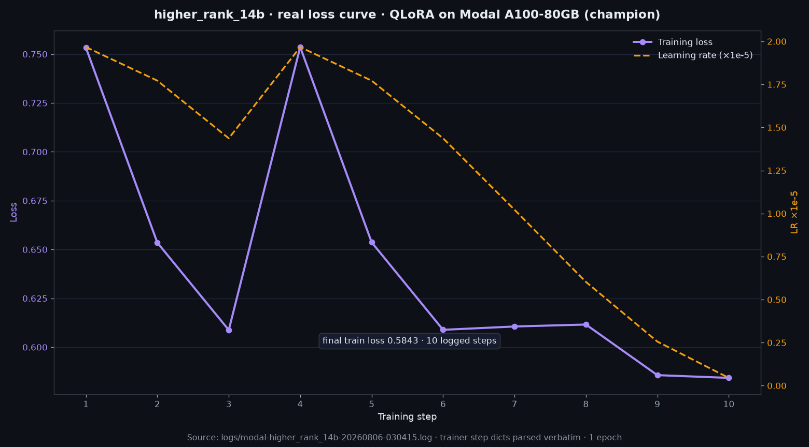
  <br/><em>Real training loss + learning rate extracted from `logs/modal-higher_rank_14b-20260806-030415.log` — QLoRA on Modal A100-80GB, the champion variant, final loss 0.5843 after 1 epoch (4,214 s ≈ 1.2 h).</em>
</p>

<p align="center">
  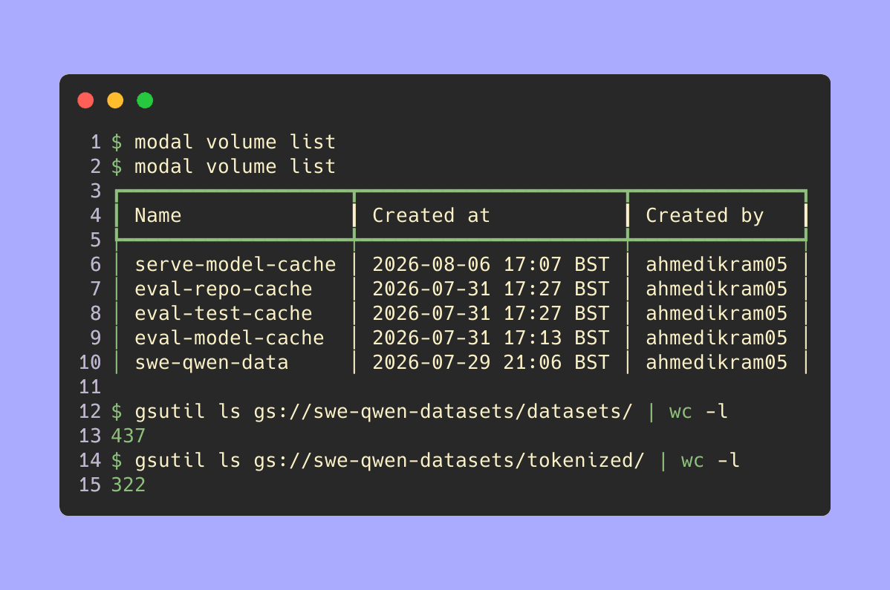
  <br/><em>Live Modal volumes (6: `serve-model-cache`, `eval-repo-cache`, `eval-test-cache`, `eval-model-cache`, `swe-qwen-data`, `swe-qwen-models`) + GCS bucket (437 dataset run dirs, 322 tokenized run dirs) → real trained artifacts: 3 adapters with `adapter_model.safetensors`, `chat_template.jinja`, tokenizer, `training_args.bin` + checkpoints.</em>
</p>

**One-command trio:**

```bash
model add meta-llama/Llama-3.1-8B-Instruct --name llama-31-8b --context 8192   # any HF causal LM; qwen3-14b is the registry default
python -m data_engineering.cli run --run-id expanded-repos                     # tokenizer/context default from the registry
modal run training/modal_train.py::train_qlora --model-name qwen3-14b --variant baseline_14b --run-id expanded-repos
python scripts/run_3config_comparison.py --run-id expanded-repos   # + --max-train-samples for smoke loops · --force-retrain to redo
```

<p align="center">
  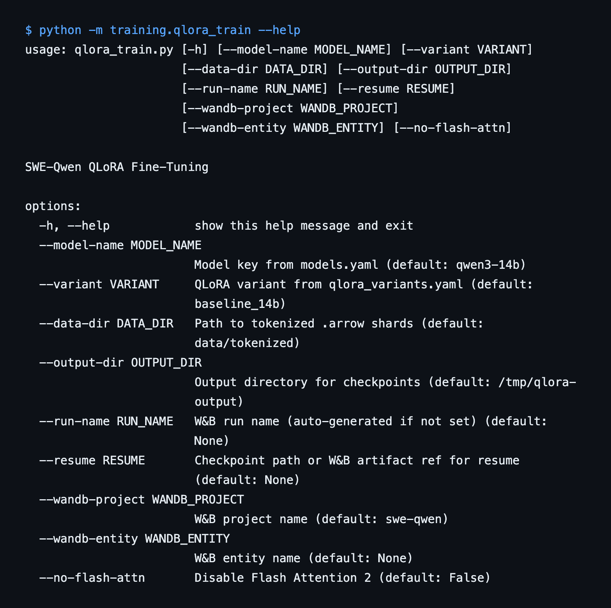
  <br/><em>The local training CLI - model, variant, run naming, resume and the tiny-model smoke path (<code>--no-flash-attn</code>), so a full training run is one command away from any registry model.</em>
</p>

See [docs/experiments.md](experiments.md) for the full training/experiment loop.

### 3. Evaluation Harness (`evaluation/`)

The harness runs **real code**: materialize `repo@base_sha` with the per-instance official SWE-bench Docker image, generate a patch with your model, **apply** it (repair + 3-strategy fallback, method recorded), then execute `FAIL_TO_PASS` and `PASS_TO_PASS` inside the container. Every cell is an `EvalResult` (`evaluation/schema.py`): instance identity, the generated patch + how it was applied, per-test outcomes, per-instance F2P/P2P scores (floats 0.0–1.0 — partial credit per test), latency, and error — the full audit trail.

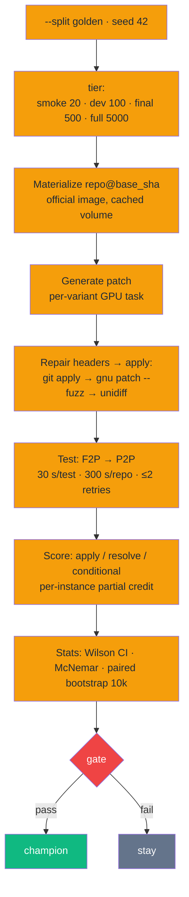

| Setting | Value | Why |
| ------- | ----- | --- |
| Tier sizes | smoke 20 · dev 100 · final 500 · full 5000 | cost-proportional confidence; smoke/dev/final sample `swebench_verified`, `full` samples the held-out golden split |
| Deterministic subset | `tier_seed = 42` | comparable runs |
| Concurrency cap | 16 remote calls | proven ceiling — 64-way concurrent `.remote()` broke modal 1.5.3's aiohttp (`'Connection' object has no attribute '_transport'`); config-level, not a CLI flag |
| `max_new_tokens` | 8,192 (all tiers) | 2,048 truncated patches mid-diff (~75% of budget goes to out-loud reasoning) |
| Patch application | `_repair_hunk_headers` first, then 3 strategies, `method_used` recorded | "patch failed" ≠ "patch wrong"; miscounted hunks get fixed before burning an apply attempt |
| Timeouts / retries | 30 s/test · 300 s/repo · ≤ 2 retries (3 attempts) | infra flapping never silently flips a score |
| Verify mode | `once_per_repo` | first instance per repo verifies ground truth, rest skip |
| Resume | `--resume run_id` | don't re-burn GPU mid-run |

<p align="center">
  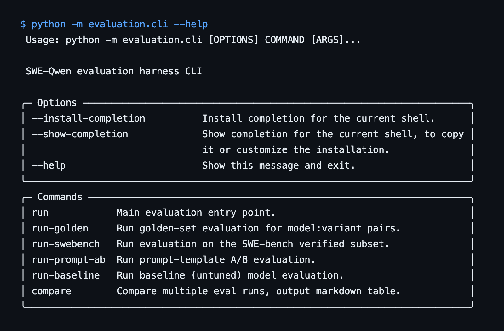
  <br/><em>The eval CLI - six subcommands: <code>run</code>, <code>run-golden</code>, <code>run-swebench</code>, <code>run-prompt-ab</code>, <code>run-baseline</code>, <code>compare</code>.</em>
</p>

**Under the hood:**

- `evaluation.cli run` fans each `model:variant` out to its **own Modal GPU task**, with the golden set resolved from `EvalConfig.golden_data_path` (`gs://swe-qwen-datasets/datasets/{run_id}/swebench/golden.jsonl`). CLI: six subcommands — `run`, `run-golden`, `run-swebench`, `run-prompt-ab`, `run-baseline`, `compare`.
- Each instance materializes `repo@base_sha` in the `eval-repo-cache` volume with its **official SWE-bench Docker image** (per-instance `swebench_image(instance_id)`; instances without a published image fall back to clone/install). The harness applies the *test patch* to establish the fail-state, then the model's patch: `_repair_hunk_headers` fixes miscounted hunks and missing headers up front, then the 3-strategy applier (`git apply` → `gnu patch --batch --fuzz=5 -p1` → `unidiff`) runs, each attempt post-checked by `_validate_applied`, recording `method_used` (`git_apply | gnu_patch_fuzz | unidiff_fallback | failed`) on every cell.
- `test_runner` executes `FAIL_TO_PASS` then `PASS_TO_PASS` inside the container — 30 s/test, 300 s/repo, ≤ 2 retries. Every cell is an `EvalResult` (patch + how it applied, per-test outcomes, partial-credit F2P/P2P, latency, error).
- Runs **resume** (`--resume run_id`), persist under `data/eval_results/` with `cost_usd` billing, and stream per-example + aggregate rows to the W&B `swe-qwen` project (`eval-results-{run_id}`, `eval-aggregate-{run_id}`, `eval-per-repo-{run_id}` artifacts; `eval/f2p_rate`, `eval/p2p_rate`, `eval/total_cost_usd`, `eval/cost_per_fix`, per-model latency p50/p95 scalars; lineage via `use_artifact model-{key}-{variant}:latest`). Langfuse logs **one trace per completed eval example** (prompt, completion, latency, scores) — never sampled.
- **Fairness by construction** (the eval-fairness hardening): a `prompt_wrap` parameter (`raw` | `chat`, default `raw`) guarantees base and LoRA variants see *identical* token prefixes on identical instances — never mixed within a batch; per-instance prompt SHA-256 fingerprints are logged so the prompt side of any comparison is auditable.

**Statistics** (`evaluation/stats.py`, stdlib-only): Wilson 95% CIs on the **binary per-instance resolve statistic** (`resolve_count/total`), McNemar's exact two-sided test on discordant pairs, and a paired bootstrap (`seed=42`, `n_boot=10_000`, percentile 95% CI). `compare` re-aggregates on the **paired** instances and reports `F2PMetrics` — rates + 95% Wilson CIs + `apply_rate` / `resolve_rate` / `conditional_resolve_rate` + latency + per-repo breakdown — then runs paired significance in two modes: **same-variant** (repeat-run variance) and **cross-variant** (same model, different variants) — the numbers behind `assets/results.txt`.

**Cost** is recorded per `EvalRun.cost_usd`: measured inference time × $0.0417/min (A100-80GB ≈ $2.50/hr) + estimated test hours × 2 vCPU × $0.008/hr. The released 400-result compare is the receipt in `assets/results.txt`.

The released reference run (100 held-out instances/model) is reproduced from `assets/results.txt` in [docs/evaluation.md](evaluation.md) — with the champion `higher_rank_14b` clearing the promotion gate (F2P 17.20% ≥ 15%, P2P 90.10% ≥ 90%).

<p align="center">
  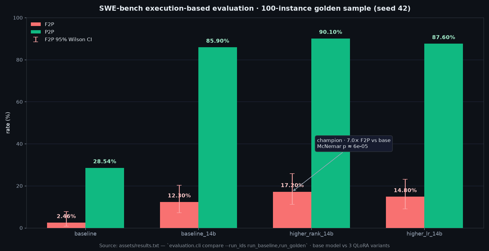
  <br/><em>Source of truth: <code>assets/results.txt</code> — <code>evaluation.cli compare --run_ids run_baseline,run_golden</code> (100 held-out instances per variant, seed 42).</em>
</p>

### 4. Promotion & Registry (`promotion/`)

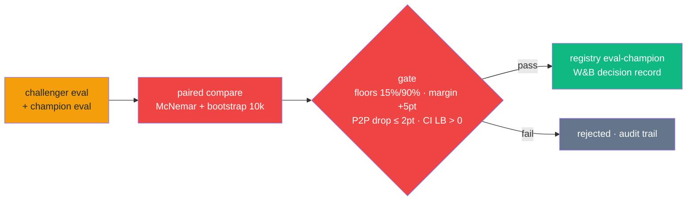

Promotion is a **decision with a paper trail**, never a merge. `promotion/` splits the concern: `run.py` (the orchestrator: candidate-model resolution, paired evals, deploy hand-off), `rules.py` (the criteria), `gate.py` (the verdict: `PairEval` + `evaluate_pair`), `registry.py` (W&B `eval-champion` + the champion record), `audit.py` (the human-readable decision record), `deploy.py` (the hand-off: deploy, health check, alias sync, rollback).

**The four conditions, checked on the same paired sample as the compare:**

| # | Gate | Exact condition | Threshold source |
| - | ---- | --------------- | ---------------- |
| 1 | **Absolute floors** | candidate F2P ≥ 15% **and** P2P ≥ 90% | `MIN_F2P_FLOOR` / `MIN_P2P_FLOOR` — hardcoded literals, deliberately **not** env-overridable (ADR-014) |
| 2 | **Real margin** | candidate F2P ≥ champion F2P + 5pt | `PROMOTE_MIN_F2P_GAIN` (env-overridable) |
| 3 | **No regression** | candidate P2P ≥ champion P2P − 2pt | `PROMOTE_MAX_P2P_REGRESSION` (env-overridable) |
| 4 | **Significance** | paired-bootstrap 95% CI lower bound **strictly > 0** (equality fails) | `evaluate_pair` |

Rejection reasons map to the gates: `fatal-flaw` (1 or 2), `regression` (3), `micro-gain` (4) — and a challenger that can't clear its own confidence interval keeps the incumbent, with the rejection written to the audit trail. Missing aggregate metrics force a `fatal-flaw` reject. (`EvalConfig.min_f2p_threshold` / `min_p2p_threshold` — the same 15%/90% values — govern a *different* path: `comparison.revalidate_champion` and the CI smoke gate.)

**Who remembers:** the champion of record is `gs://swe-qwen-datasets/ci/champion.json` (9 required fields: variant, model_ref, f2p_rate, p2p_rate, dataset_run_id, tier, seed, promoted_at, previous). Readers: `promote.yml` (both jobs — required), `eval.yml` (warn-and-continue; derives the smoke gate's `--models` from its `model_ref`), and `promotion/run.py`. **The only writer to GCS is `promote.yml`'s upload step**, gated on the deploy step *succeeding* (not `always()` — a rolled-back deploy must not publish its champion); `registry.py` appends the full decision record to the W&B `eval-champion` collection; deployment is gated to the `production` environment.

```bash
python -m evaluation.cli compare --run_ids run_baseline,run_golden   # statistics; promotion is attempted best-effort automatically
gh workflow run promote.yml -f candidate_variant=higher_rank_14b     # CI champion/challenger (candidate_model optional: arg > champion record > config)
```

`promote.yml` runs three jobs — init-wandb → decide → deploy. A rejection emits no deploy outputs, skips deploy, and exits 0 ("rejection is a successful outcome, not a failure"). A kill switch (`RUN_MODAL_EVAL=false`) runs the whole decision path without Modal spend. The champion adapter ships on the Hugging Face Hub with its own model card: `promotion/MODEL_CARD.md` → [`ahmedikram/SWE-Qwen-qwen3-14b-higher_rank_14b`](https://huggingface.co/ahmedikram/SWE-Qwen-qwen3-14b-higher_rank_14b).

### 5. Inference Serving (`inference/`)

OpenAI-compatible API surface — **your client code doesn't change**. Exactly two endpoints: `POST /v1/chat/completions` (stream + non-stream) and `GET /health`. Models resolve as `{key}:{variant}`, `model-{key}-{variant}`, bare `{variant}`, or — importantly — **bare `{key}` resolves to the registry `default_variant`: the champion LoRA, not the bare base** (pass the base name only when no default variant is configured). Unknown variant → 404; unresolvable adapter → warn + serve the base.

| Endpoint | Auth | Behavior |
| -------- | ---- | -------- |
| `POST /v1/chat/completions` | Bearer (`MODAL_SERVE_TOKEN`, `hmac.compare_digest`, read lazily per request, fail-closed) | chat completion, SSE streaming (`data: [DONE]`) |
| `GET /health` | open | `{status, model, engine}` |

**Wire format** — OpenAI-compatible (`model_config = {"extra": "ignore"}`), full schemas in [docs/api.md](api.md):

```json
// POST /v1/chat/completions · Authorization: Bearer $MODAL_SERVE_TOKEN
{ "model": "qwen3-14b:higher_rank_14b", "messages": [{ "role": "user", "content": "Explain QLoRA in one sentence" }],
  "temperature": 0.1, "top_p": 0.95, "max_tokens": 512, "stream": false }
```

Streaming returns SSE `data: {json}\n\n` frames — role chunk → content chunks → final (`finish_reason:"stop"`) → `data: [DONE]` (chunks are whitespace-delimited). `max_tokens` is clamped to a server cap. Errors: `401 {"detail":"invalid or missing bearer token"}` (FastAPI-style, not recorded in telemetry), then faithful OpenAI envelopes for `422 invalid_request_error`, `404 model_not_found`, `500 server_error`.

**Under the hood:**

1. **Auth first.** Every completion checks the Bearer token against `MODAL_SERVE_TOKEN` with `hmac.compare_digest`, fail-closed (401 before any prompt touches the model); `/health` stays open. Per-request order: auth → pydantic validation (422) → model resolution (404) → engine call.
2. **Model resolution** (`openai_compat.resolve_engine_model`): bare `{key}` → `default_variant` (champion LoRA); `{key}:{variant}` / `model-{key}-{variant}` / bare `{variant}` (if registered) → that variant; anything else → 404.
3. **VLLMEngine** (`SERVING_STUB=0`) holds a process-singleton `_LLM_CACHE` keyed by the engine model id — one process on the resolved base (this run: AWQ int4 `Qwen/Qwen3-14B-AWQ`) with `enable_lora=True`, `max_lora_rank=64`, gpu_mem 0.85, 16 max seqs, `max_model_len` = registry context (32,768), and a per-request `LoRARequest(lora_name, lora_int_id=1, lora_path)`. The **first request for a variant pulls the LoRA weights from W&B** (`model-{key}-{variant}:latest`, demonstrated: 1,399.16 MB / 40 files) and caches them on the `serve-model-cache` volume — serverless adapters, zero pre-provisioning, zero engine restarts. Unknown base model fails loud (`KeyError`).
4. **Prompt assembly differs by model type** — LoRA models are conditioned on the raw `### Response -> patch` continuation with the `no_think` soft-switch when the registry flags it (this run: Qwen3 `/no_think\n### Response`, first occurrence only); the base model gets the full chat template with `enable_thinking=False` only for flagged models — a 14B that "thinks out loud" burns ~75% of the budget before diffing. `/no_think` is **never** inserted by training or eval (contract: `NO_THINK_POLICY = "inference_wrapper_only"`).
5. **Telemetry on every request**: a `RequestRecord` (`ts · model · stream · ttfbs_ms · latency_ms · output_tokens · error · error_type · status`) goes to the observability layer; TTFB is captured at the first streamed chunk. Langfuse: **every error traced, successes sampled at 10%** (`telemetry_trace_sample_rate`).
6. **StubEngine** (default, deterministic local dev — flip with `SERVING_STUB=0`) echoes `stub[{lora_name or "base"}]: …` so the full API path — auth, resolution, streaming, telemetry — is testable without a GPU.

<p align="center">
  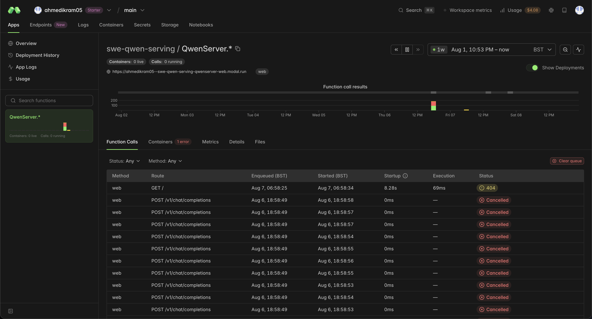
  <br/><em>Modal serving endpoint (class <code>ModelServer</code>, per-model GPU) - the vLLM + LoRA server sits at zero/cold until a request scales it up; per-request GPU billing, no idle cost.</em>
</p>

<p align="center">
  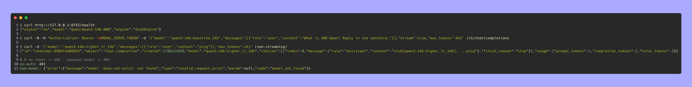
  <br/><em>Live server: `/health` → `StubEngine`, real `chatcmpl-998dfe608954` completion, 401 without bearer token, `model_not_found` envelope. The first request per model pulled the 1.4 GB LoRA adapter from W&B into cache.</em>
</p>

<p align="center">
  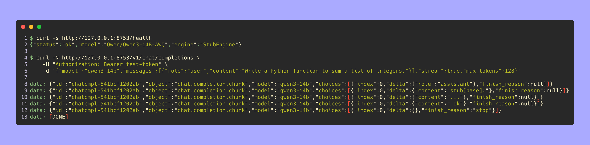
  <br/><em>Same server, streaming path (port 8753): <code>stream: true</code> chunks arrive as SSE <code>data:</code> events and terminate with <code>[DONE]</code>, one request from Python-function prompt to stop.</em>
</p>

Measured serving performance (250-request benchmark, [docs/planning/SERVING-BENCHMARK-REPORT.md](planning/SERVING-BENCHMARK-REPORT.md)): warm p50 TTFB ≈ 4.9 s at concurrency 1, ~140–150 s cold start, throughput scaling to 8-way concurrency (~227 tok/s aggregate) and flattening at 16; aggregate TTFB p50 14.4 s across the ramp including cold starts. SLO targets are set with headroom above the measured warm path (`observability/slo.py`).

### 6. Observability (`observability/`)

Every layer of the platform phones home, and the dashboards that visualize it are versioned in this repo.

- **Weights & Biases** — two projects: `swe-qwen-data` (every pipeline artifact `raw → validated → cleaned → train/val/test → golden → tokenized`, real per-stage `manifest.json`, `dataset_card.md`) and `swe-qwen` (training runs with live loss curves, eval runs with per-example rows + aggregates + `cost_usd`, and the `eval-champion` registry collection).
- **Langfuse** — serving: **every error traced, successes sampled at 10%** (`telemetry_trace_sample_rate`); evaluation: one trace per completed example (prompt → completion → latency → scores); training has no Langfuse path. Every SDK call is wrapped — Langfuse can never break eval or serving.
- **Structured logs** — `configure_logging()` emits JSON logs to stdout (Modal container logs): every inference request is a `RequestRecord` (`ts · model · stream · ttfbs_ms · latency_ms · output_tokens · error · error_type · status`), so latency regressions are queryable, not anecdotal.
- **Dashboards as code** — `scripts/build_dashboards.py` + `scripts/seed_dashboards.py` (`wandb-workspaces`) keep the W&B dashboards in git: 26 panels across 4 workspaces (Training 5 · Evaluation 6 · Serving 8 · Infrastructure/Cost 7), all fed from a `METRIC_REGISTRY` of 8 domains / 56 metric keys that a pure-AST contract test enforces. `docs/observability/architecture.md` + `dashboards.md` document the layout.
- **Cost** — `observability/cost.py` folds Modal + GCS spend into each `EvalRun.cost_usd` (GPU rate table in `config/observability.yaml`; `OBSERVABILITY_RATE_PER_HOUR` overrides).
- **SLOs** — `observability/slo.py` carries `SLO_TARGETS` (`ttfb_p50_ms` 25,000 · `cold_start_s` 180 — set with headroom above the measured warm path and cold start), a 99% error budget, and burn-rate alerting (warn at 1×, page at 5×).

<p align="center">
  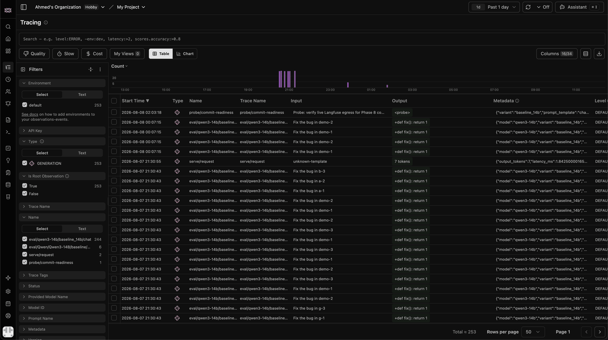
  <br/><em>Langfuse - one request traced end-to-end (prompt → generated patch → latency); serving traces every error and samples successes at 10%.</em>
</p>

<p align="center">
  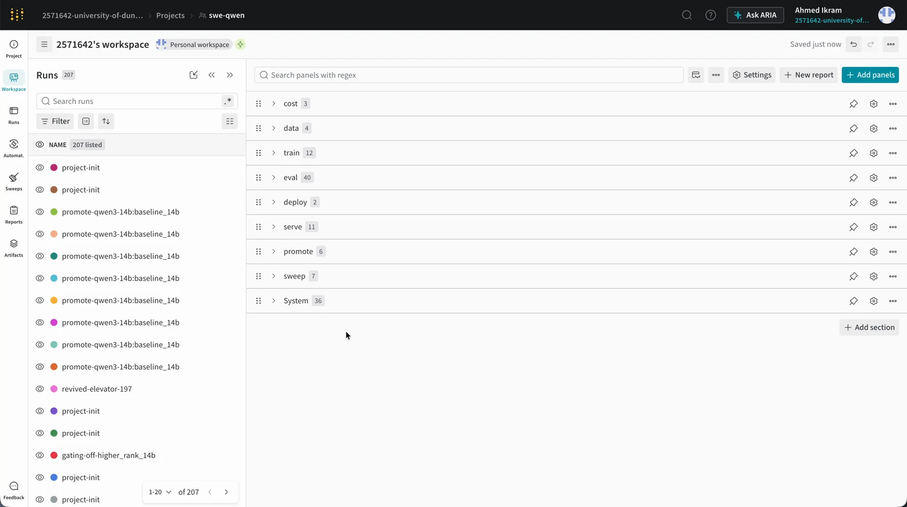
  <br/><em>W&B workspaces - dashboards as code: `scripts/build_dashboards.py` + `scripts/seed_dashboards.py` (wandb-workspaces) keep the layout in git, not in a browser tab.</em>
</p>

## Testing Strategy

| Layer | Tooling | Coverage of |
| ----- | ------- | ----------- |
| Unit + integration | pytest (**1753 tests passed** (1755 collected: 1 skipped, 1 deselected), 4:19) | every package: data_engineering, evaluation, inference, training, promotion, observability, scripts, registry — 72 test files |
| Lint / format | ruff 0.17 (line-length 100, strict rule set, 9 dirs) | `All checks passed` |
| Type checking | mypy (strict-ish) | 76 source files across 8 packages, `Success: no issues found` |
| Coverage | pytest-cov (`--cov`, branch=true, `--cov-fail-under=90`) + Codecov | 8 packages |
| Model regression | `eval.yml` smoke gate (20-instance F2P vs baseline with `--models` from champion.json, `_SMOKE_TOLERANCE=0.05`, PRs read / main writes) | catches real model-quality regressions per PR |

**Contract tests** — the invariants that make the pieces compose:

- `tests/test_contract_config.py` — tokenize length ≤ trainer window (capped by registry context); `packing=False` on the pre-tokenized path; `save_steps < total_steps`.
- `tests/test_contract_determinism.py` — `stratified_split` reproducible; split seed pinned 42 (run-id-derived only under `run_id_override`).
- `tests/test_contract_prompt_parity.py` + `tests/test_prompt_parity.py` — the train builder ≡ the eval builder: same system text, snippet caps (20 files / 10 test files / 5 × 150 lines), few-shot policy, and the `NO_THINK_POLICY = "inference_wrapper_only"` contract.
- `tests/observability/test_telemetry_contract.py` — a pure-AST walk asserting every `wandb.log` / `log_metrics` dict literal uses a registered `METRIC_REGISTRY` key.

<p align="center">
  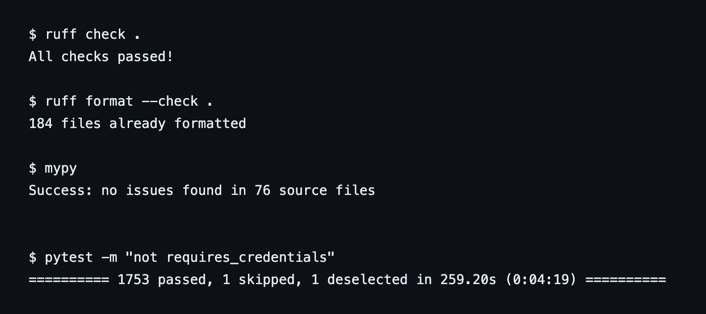
  <br/><em>All four quality gates on the current tree: <code>ruff check</code> clean · <code>ruff format</code> clean (184 files) · <code>mypy</code> clean (76 source files) · <strong>1753 tests passed, 1 skipped, 1 deselected</strong> in 4:19.</em>
</p>

> The full offline suite runs green in about 4¼ minutes (`pytest -m "not requires_credentials"`, 1 deselected = credential-gated test).

Run locally:

```bash
uv sync --extra dev
ruff check . && ruff format --check . && mypy
pytest -m "not requires_credentials"
```

---

## Infrastructure (Terraform)

```text
infra/terraform/                  <- GCS remote state (swe-qwen-terraform-state)
├─ providers.tf · main.tf · variables.tf · outputs.tf
├─ terraform.tfvars.example       (tfvars itself gitignored)
├─ modules/storage/                (2 buckets + lifecycle + IAM)
└─ modules/iam/                    (WIF pool/provider, 3 service accounts, secrets, Artifact Registry)
```

- **State & storage as code**: bucket naming/lifecycle/IAM parameterized (`dataset_bucket_name`, `model_bucket_name`, `enable_workload_identity=true`); both buckets versioned with tiered lifecycle rules (dataset → Nearline 90 d → Coldline 365 d → delete > 365 d & > 3 newer; models on a 30/180/730-day ladder).
- **Workload Identity Federation** for GitHub Actions (OIDC pool + provider with an `attribute_condition` pinning repository owner + name) — no service-account keys allowed by org policy. 3 service accounts (Modal runner, GitHub Actions, Cloud Build), 3 Secret Manager secrets, an Artifact Registry repo, and 18 project-level IAM grants declared in the `iam` module; 13 GCP APIs auto-enabled.
- **CI/CD wiring**: `cd.yml` plans on PRs, applies to `production` on push-relevant-changes (paths: `infra/**`, `inference/**`, `config/**`, `pyproject.toml`, `uv.lock`), then `modal deploy` (gated by a `GCP_DEPLOY_ENABLED` master switch; deploy telemetry is best-effort and never red-outs a deploy).
- **Eval volumes**: `eval-repo-cache` + `eval-test-cache` (+ `eval-model-cache`); training outputs → `swe-qwen-models`; inference adapters → `serve-model-cache`.
- **Known posture note**: in the `dev` environment the dataset bucket grants `roles/storage.objectViewer` to `allUsers` (public read) — that is what lets Modal pull tokenized corpora and the eval harness pull golden data with zero credentials. The org policy forbids the alternative (HMAC keys).

---

## CI/CD Pipeline

Five GitHub Actions workflows (+ Dependabot):

| Workflow | Job | Key config |
| -------- | --- | ---------- |
| `ci.yml` | lint + typecheck + tests + terraform validate | ruff · mypy · pytest `-n auto --cov-fail-under=90` (offline markers) · 3-layer caching · paths-ignore `**.md`, `docs/**` · concurrency cancel-in-progress |
| `cd.yml` | infra plan / apply + Modal deploy | `pull_request` plan (published to the step summary + 7-day artifact) · `push main` apply gated on `GCP_DEPLOY_ENABLED` · env `production` · `SERVING_BASE_MODEL` / `SERVING_GPU` pins for the serving deploy · bare-repo-name guard protects the WIF claim |
| `eval.yml` | SWE-bench smoke gate | 20-instance F2P vs `smoke_baseline.json` · `--models` derived from champion.json `model_ref` · three-way failure (drop > 5%, below the 15% floor, or a baseline key missing) · dataset-run-id stamp invalidates stale baselines · PRs read / main writes |
| `promote.yml` | champion/challenger promotion | `candidate_model` + `candidate_variant` inputs · paired eval (`--mode dev` = 100 instances) · 4-condition statistical gate · W&B decision record · only a *successful* deploy publishes champion.json · optional dry-run via `RUN_MODAL_EVAL=false` |
| `codeql.yml` | security analysis | Python + GitHub Actions, SHA-pinned actions · `security-extended` suite on the weekly Monday schedule, default suite on PR/push |
| Dependabot | weekly (Mon 09:00 Europe/London) | pip (deliberately not uv — resolver can't satisfy the marker splits) + github-actions, grouped minor/patch, hard-ignores: torch (vllm pin lock) and transformers ≥ 5.15 (removed `warmup_ratio`) |

<p align="center">
  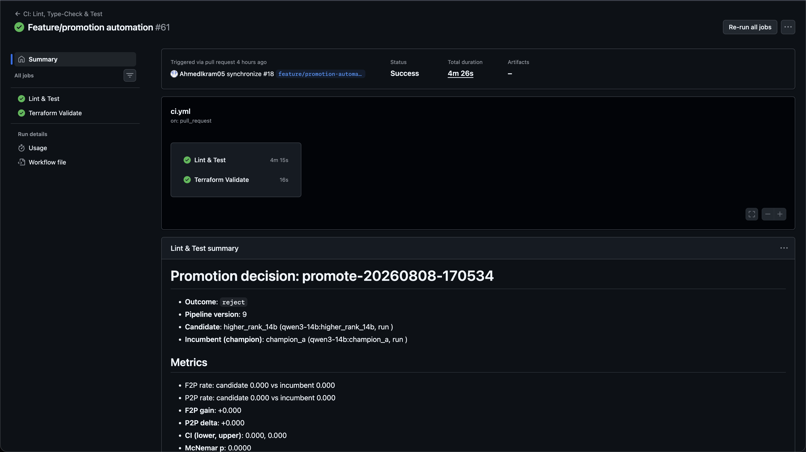
  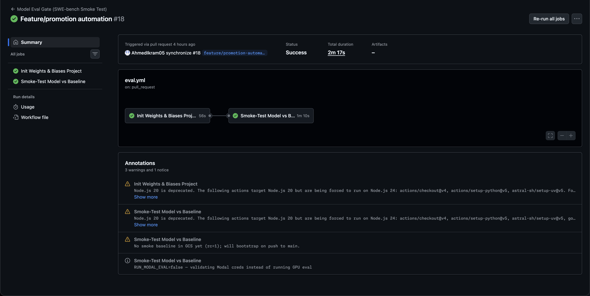
  <br/><em>Left: `ci.yml` - ruff + mypy + the full pytest suite. Right: `eval.yml` - the SWE-bench smoke gate on PRs (baseline read-only for PRs, updated on main).</em>
</p>
<p align="center">
  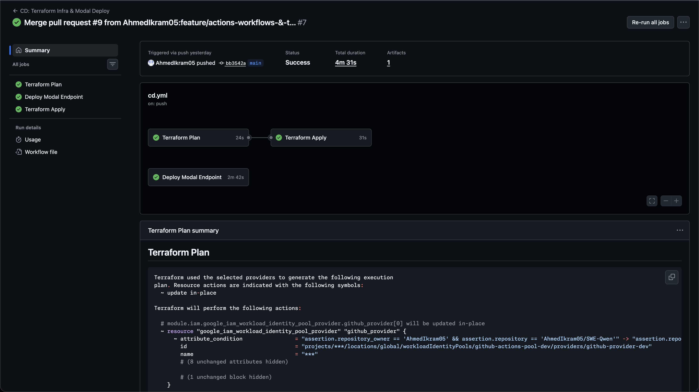
  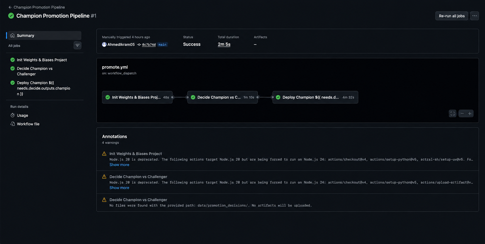
  <br/><em>Left: `cd.yml` - Terraform plan/apply + Modal deploy, gated to production. Right: `promote.yml` - champion-vs-challenger statistical promotion with the 4-condition gate.</em>
</p>

---

## Security Model

| Layer | Mechanism |
| ----- | --------- |
| Cloud auth | GCP Workload Identity Federation (OIDC, short-lived tokens, repository-pinned attribute condition) - org policy blocks SA keys |
| Machine access | Modal Secrets (`wandb-secret`, `hf-secret`) |
| API auth | Bearer token, constant-time compare, fail-closed, 401 on missing; 401s never recorded in telemetry |
| Inference isolation | private Modal net, per-request LoRA, no static credentials |
| Data | public-read dataset bucket in `dev` (credential-free pulls for Modal/eval), private-by-default posture elsewhere; VPC-SC-ready |
| CI secrets | GitHub Secrets (WIF provider, GCP ids, Modal tokens, W&B key, HF token, serve token, Codecov token) |
| Supply chain | CodeQL (Python + Actions) weekly `security-extended`; Dependabot with curated ignore rules; SHA-pinned third-party actions |
