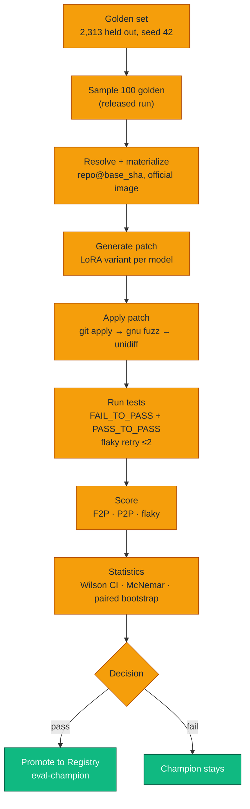

# Evaluation Methodology — F2P / P2P, Statistics, Golden Set Protocol

> SWE-Qwen does **execution-based** evaluation: it applies the model's generated patch inside the official SWE-bench container for that instance and runs the real test suites. No unit-test proxies, no LLM-as-judge. Code of truth: `evaluation/` (`harness.py`, `test_runner.py`, `patch_applier.py`, `stats.py`, `schema.py`).



---

## 1. Core Metrics

For each evaluated instance (`EvalResult` in `evaluation/schema.py`) the harness records: model, variant, prompt template, the generated patch, patch-application metadata, tests before/after, `f2p` and `p2p` (floats 0.0–1.0 — partial credit per test, not binary), latency, and any error. The binary per-instance **resolve statistic** is a derived predicate (`error is None` and `f2p == 1.0`) — it is what the Wilson CIs and McNemar in §3 operate on.

| Metric | Definition | Meaning |
| ------ | ---------- | ------- |
| **F2P (Fail-to-Pass)** | The model's patch caused ≥1 list item of `FAIL_TO_PASS` to flip from failing → passing, with no output above | The fix actually fixed the bug. This is the headline score |
| **P2P (Pass-to-Pass)** | Proportion of `PASS_TO_PASS` tests still passing after the patch | Regression safety: did the "fix" break unrelated behavior? 1.00 = nothing regressed |
| **Flaky rate** | Tests flapping across retries (≤2 retries, `flaky_threshold` 0.5) | Noise floor for trusting P2P |

Per-model aggregation is `F2PMetrics`: counts + rates for F2P and P2P, `avg_latency`, `flaky_test_rate`, and a **per-repo breakdown** (so a model that "wins" only on easy repos is visible).

### Reference result (released run — 100-instance golden sample, 4 variants)

| Model | Variant | F2P (Wilson 95% CI) | P2P | Avg latency | Flaky | Note |
| ----- | ------- | --- | --- | ------- | --- | --- |
| Qwen3-14B | base (`baseline`) | 2.46% (0.8–7.7%) | 28.54% | 10.04s | 0.06% | rejected: p2p<90%, f2p<15% |
| Qwen3-14B | `baseline_14b` | 12.30% (7.2–20.2%) | 85.90% | 9.47s | 0.03% | rejected: p2p<90% |
| Qwen3-14B | `higher_rank_14b` | **17.20% (11.1–25.8%)** | **90.10%** | **8.92s** | **0.01%** | **champion** |
| Qwen3-14B | `higher_lr_14b` | 14.80% (9.1–23.1%) | 87.60% | 9.12s | 0.02% | rejected: p2p<90% |

**Reading the numbers:** the released run is a 100-instance sample of the 2,313-example golden set — a real comparison, not a smoke test. `higher_rank_14b` clears every gate (F2P 17.20% ≥ 15%, P2P 90.10% ≥ 90%, significant gain over the base model) and is marked **champion**; the other three variants are rejected for failing the P2P floor. `McNemar p ≈ 6e-05` and paired-bootstrap 95% CI lower bound > 0 confirm the F2P gain over the base Qwen3-14B (2.46% → 17.20%, 7.0×) is not chance, and `P2P Δ +61.6pt` (28.54% → 90.10%) quantifies the regression-safety win.

---

## 2. Pipeline Detail

### 2.1 Sampling (`eval run --split`)

| Variable | Value |
| -------- | ----- |
| Source | `swebench_verified` (default for a bare `run`, sampled at 50) or `golden` — golden sampling is via `--split golden` or the tiered `--mode full` |
| Seeding | `tier_seed = 42`, deterministic subsetting |
| Tier sizes | `smoke` 20 · `dev` 100 · `final` 500 (sampled from `swebench_verified`) · `full` 5000 (samples the held-out golden split) |
| `--sample N` override | truncates the sampled split (`--sample 0` on golden caps at the `full` tier); the released run used an explicit 100-instance golden sample |

### 2.2 Execution

1. **Materialize** `repo@base_sha` with the official per-instance SWE-bench Docker image (cached on Modal, `eval-repo-cache` / `eval-test-cache` volumes).
2. **Generate** the patch: `--models qwen3-14b:baseline_14b,...` — each model string is copied to its own GPU task. Concurrency is capped at 16 remote calls — a proven ceiling: 64-way concurrent `.remote()` broke modal 1.5.3's aiohttp client (`'Connection' object has no attribute '_transport'`). It's a config value (`EvalConfig` / `EVAL_*` env), not a CLI flag — there is no `--max-parallel`.
3. **Apply** (`patch_applier.py`): `_repair_hunk_headers` runs *before* the first apply attempt (recomputes miscounted hunk counts, injects missing `---`/`+++` headers), then a layered strategy — `git apply` → GNU `patch --batch --fuzz=5 -p1` → `unidiff` fallback — with each strategy post-checked by `_validate_applied` and *recorded* (`method_used` ∈ `git_apply` | `gnu_patch_fuzz` | `unidiff_fallback` | `failed`), so "patch failed to apply" is diagnosably different from "patch applied but wrong".
4. **Test**: run `FAIL_TO_PASS` then `PASS_TO_PASS` inside the container; 30s per test, 300s per repo, ≤2 retries for flakes.
5. **Resume**: `--resume run_id` continues an interrupted run instead of re-burning GPU.

### 2.3 Cost controls

- Modal containers cold-start once; repo + image caching makes subsequent runs cheap.
- `--sample 50` keeps a CI inference run ~$1; a full golden run is bounded by `--sample`.
- Cost is recorded per `EvalRun`: `cost_usd` = measured inference latency × $0.0417/min for the A100-80GB + estimated test hours × 2 vCPU × $0.008/hr. The **$30 est. total** in `assets/results.txt` is the recorded estimate from the original 2-run × 4-model comparison (100 golden instances) — a receipt, not a reproducible quote.

---

## 3. Statistical Grounding (`stats.py`)

Raw rate differences on finite samples are noise. Every comparison that can promote a champion uses:

| Method | Used for |
| ------ | -------- |
| **Wilson score interval** | 95% confidence interval around the binary per-instance resolve rate (`resolve_count / total`), reported per model |
| **McNemar's test** | Exact two-sided binomial on the discordant pairs of two models' per-instance outcomes — is the F2P gain real on the same instances? |
| **Paired bootstrap** | CI for the difference (gain) under resampling of instance-level outcomes — `paired_bootstrap_ci(seed=42, n_boot=10_000)` |

The eval gate (`promotion/gate.py`) then requires, to promote a challenger:

1. **Absolute floor**: F2P ≥ `min_f2p_threshold` (15%) and P2P ≥ `min_p2p_threshold` (90%) on the paired dev eval.
2. **Gain is real**: challenger beats champion by the required margin **with a CI lower bound > 0** (i.e. McNemar says the improvement is not a coin flip).
3. **No regression**: P2P drop ≤ 2 points across the paired set.

Silent promotions (within noise) are rejected by design — a "win" that can't clear its own confidence interval is a fluke, not a win.

### 3.1 CI / smoke gating (`eval.yml`)

- `--mode smoke` runs the 20-instance tier as a **merge gate** on PRs touching eval/training/inference/config.
- **Baseline**: `{output_dir}/smoke_baseline.json` stores `{"dataset_run_id", "rates": {model:variant:prompt: f2p_rate}}`. PRs read it; pushes to `main` update it (`--update-baseline`) — self-certification is impossible.
- **Tolerance**: `_SMOKE_TOLERANCE = 0.05` absolute F2P drop against the baseline, plus the absolute `min_f2p_threshold` floor.

### 3.2 Evaluation fairness (P0-5)

Variant comparisons are only fair if every confounder except the model is
pinned. `evaluation/inference.py` and `evaluation/comparison.py` enforce:

- **Unified prompt wrapping.** One wrapping function is applied to ALL
  variants in a batch: `prompt_wrap="raw"` (default) feeds base AND LoRA the
  raw `### Response -> patch` continuation (matching how the adapters were
  trained); `prompt_wrap="chat"` is the both-wrapped ablation. The old fork
  (base chat-wrapped, LoRA raw) changed the token prefix between variants on
  identical instances — an eval artifact, not a model difference. A sha256
  hash of each final (wrapped) prompt is logged per instance, so the prompt
  side of any comparison is auditable.
- **Split rates, not one conflated F2P.** `F2PMetrics` reports
  `apply_rate` (patch applied / total) separately from `resolve_rate`
  (instance-resolve, strict `F2P == 1.0`, / total) and
  `conditional_resolve_rate` (resolved | applied). "Patch failed to apply"
  is no longer indistinguishable from "patch applied but wrong" in the
  headline number.
- **Wilson CI on the binary statistic.** The reported 95% CI bounds
  instance-resolve (`resolve_count / total`) — a binomial CI on the mean
  partial-credit `f2p_rate` is invalid (partial 0.5s are not Bernoulli
  trials).
- **Cross-variant paired significance.** `paired_significance` pairs the
  same model under two different variants on identical instances (McNemar +
  paired bootstrap over strict instance-resolve outcomes), in addition to
  same-variant repeat-run pairing.
- **Eager vs compiled variance.** Probe/smoke batches (<32 prompts) run on
  an `enforce_eager` vLLM engine; larger batches run compiled
  (torch.compile + CUDA graphs). The two engines can decode the same prompt
  to slightly different tokens (different sampler kernels) — a known small
  confounder. Compare variants at equal batch size (hence equal engine mode)
  with identical sampling params (temperature/top_p/max_tokens).

---

## 4. Golden Set Protocol

Why `golden` is sacred:

1. **Held out for evaluation.** The golden set (`golden.py`) is carved from the repo-stratified **test** split (verified/test/dev SWE-bench provenance filtered within it; `golden_source_split` defaults to `"test"`) and held out from the training split; the isolation check errors if any golden instance overlaps train/val.
2. **Run-scoped.** Binds to a dataset `run_id` (`EVAL_DATASET_RUN_ID`); evaluation can never silently pick up a "better" oracle that makes results harder to compare.
3. **Fixed prompts.** Prompt templates live in `training/prompts/` and are shared with inference (`prompt_builder.py`) — an eval result is attributable to the model, not an ad-hoc prompt.
4. **Full audit.** Every run is a `EvalRun` in W&B (`swe-qwen` project) with per-example logging (patch + status), aggregate metrics, and `cost_usd`; a `compare` writes a markdown table and then attempts promotion to the `eval-champion` registry collection best-effort (revalidate the champion, then promote). Langfuse logs one trace per completed eval example (never sampled), addressable by `run_id` + `instance_id`.

---

## 5. Reproduce

```bash
export EVAL_DATASET_RUN_ID=expanded-repos

# Full 100-instance golden-sample comparison (4 variants) — released run
python -m evaluation.cli run --split golden --sample 100 --models qwen3-14b:baseline --resume run_baseline
python -m evaluation.cli run --split golden --sample 100 \
  --models qwen3-14b:baseline_14b,qwen3-14b:higher_rank_14b,qwen3-14b:higher_lr_14b --resume run_golden

# Statistical comparison — promotion is attempted automatically (best-effort)
# after revalidating the champion; there is no --promote-to-registry flag.
# The CI promotion path is promote.yml.
python -m evaluation.cli compare --run_ids run_baseline,run_golden

# CI gate only (no promotion)
python -m evaluation.cli run --mode smoke --ci-mode --models qwen3-14b:baseline_14b
```

---

## 6. Known Limitations

- **Execution on sampled splits** keeps costs sane; small samples have wide Wilson intervals — that's *why* the gate demands the CI lower bound.
- **P2P on 100-instance samples** is a moderate regression signal; larger golden runs tighten it further.
- **Image caching** keeps repos warm; brand-new instances pay a one-time cold start.
- **Flaky retries** guard against infra flapping but cannot catch deterministic environment drift (tracked via `flaky_rate`).
- **Engine mode** (eager for <32-prompt batches vs compiled otherwise) can shift individual decodings slightly (§3.2) — pair variants at equal batch size.
